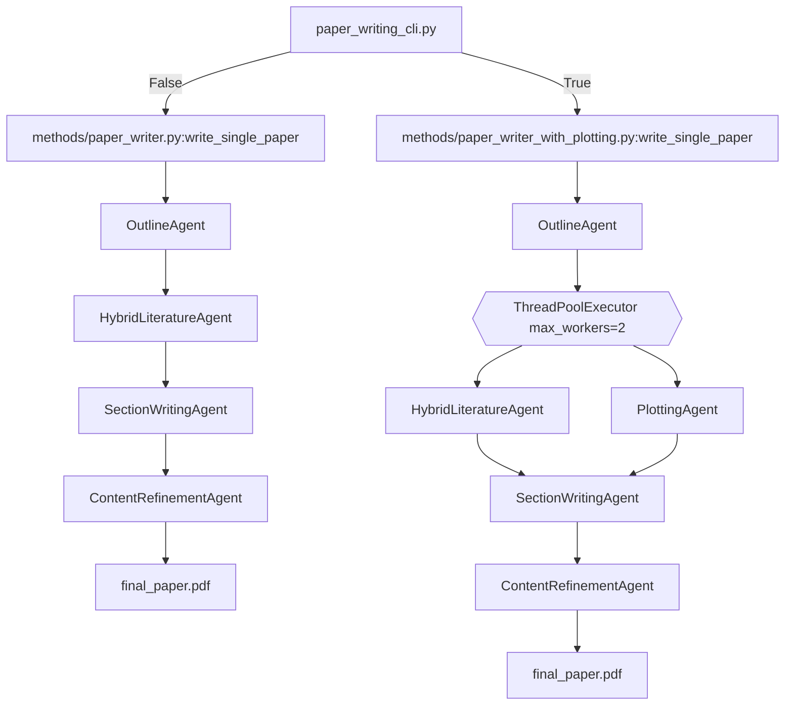
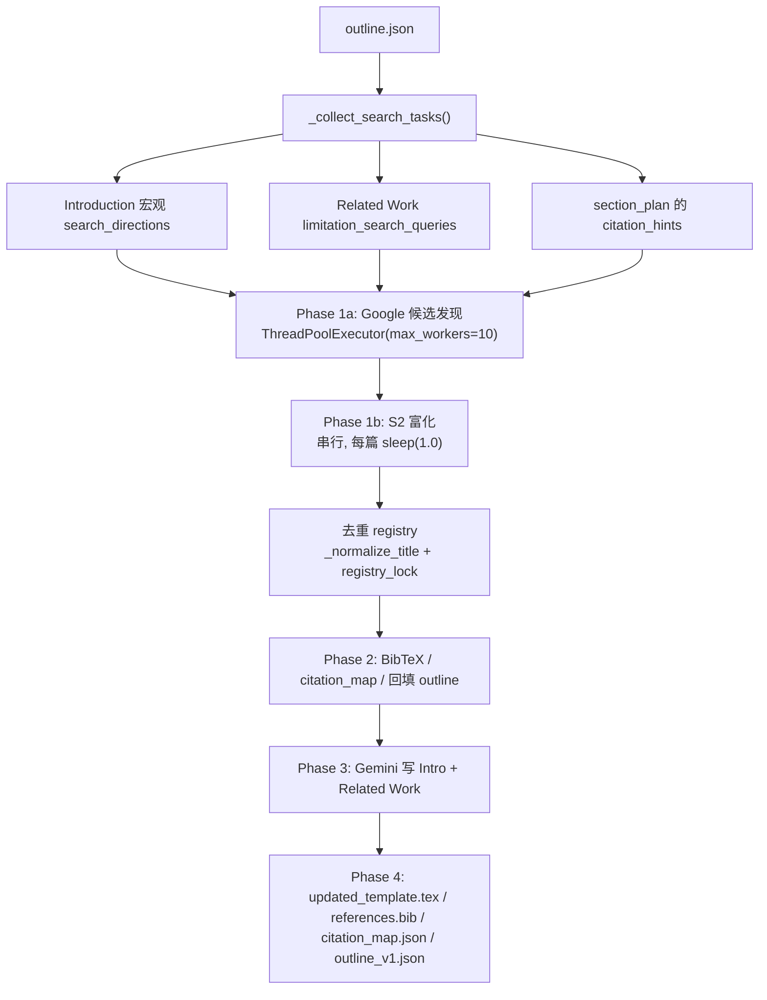
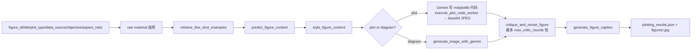
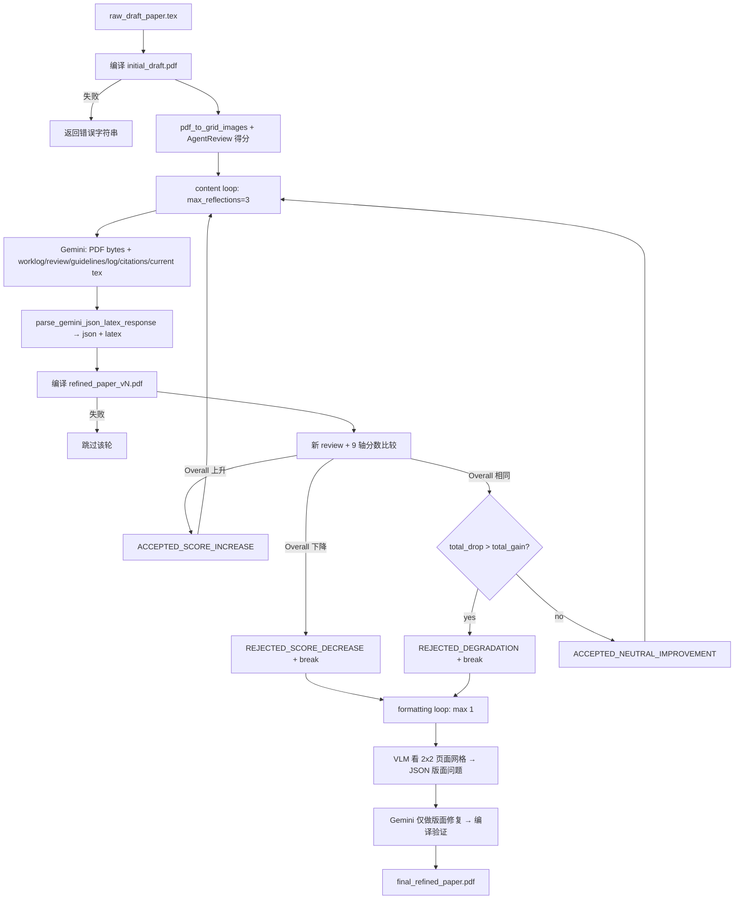

# PaperOrchestra 五大 Agent 编排深度解析

> 源码快照：`d9bae997e793a015ed38bb1605be9eb58c00284f`（`d9bae99`）。本文按实际调用链描述，不把 `methods/prompts/format_agent.py` 中未接入主路径的模板误称为独立 Agent。

## 1. 总览：两条主路径与统一交接方式

入口 `paper_writing_cli.py:main()` 根据 `--use_plotting` 分流：



两条路径都包在 `max_n_tries = 3` 的异常重试里；每次重试开始都会删除并重建 `latex_writeup/`，删除 `final_paper.pdf`。`outline.json`、`literature_agent_output/`、`plotting_results.json`、`content_refinement_workdir/` 的重置时机各不相同，第二轮可能复用第一轮中间产物。

Agent 之间没有 Python 对象总线；**磁盘文件就是数据契约**：

| 文件 | 生产者 | 消费者 | 关键结构 |
|---|---|---|---|
| `raw_materials/idea*.md` | 用户 | Outline/Literature/Section/Refinement | 自由 Markdown |
| `raw_materials/experimental_log.md` | 用户 | 全部写作 Agent | 自由 Markdown；数字真值 |
| `raw_materials/figures/*` | 用户或无绘图路径 | SectionWriting | `.png/.jpg/.pdf` |
| `outline.json` | OutlineAgent | Literature/Section/Plotting | `plotting_plan`, `intro_related_work_plan`, `section_plan` |
| `outline_v1.json` | LiteratureAgent | 回写为 `outline.json` | 同上 + `citation_candidates` |
| `literature_agent_output/updated_template.tex` | LiteratureAgent | SectionWriting | 填好 Introduction/Related Work 的模板 |
| `literature_agent_output/references.bib` | LiteratureAgent | 复制到 `latex_writeup/references.bib` | BibTeX |
| `literature_agent_output/citation_map.json` | LiteratureAgent | SectionWriting/Refinement | `{key: {citation_key,title,authors,venue,year,abstract}}` |
| `plotting_results.json` | PlottingAgent | writer 生成 `figures/info.json` | 每张图的结果数组 |
| `latex_writeup/figures/info.json` | writer | SectionWriting | `[{name, caption}]` |
| `latex_writeup/raw_draft_paper.tex` | SectionWriting | ContentRefinement | 完整 LaTeX |
| `content_refinement_worklog.json` | ContentRefinement | 下一轮 refinement | `{vN: {scores_before, scores_after, deltas, outcome, ...}}` |
| `format_refinement_worklog.json` | ContentRefinement | 审计 | 版面修复结果 |
| `final_refined_paper.pdf/tex` | ContentRefinement | 复制为 `final_paper.pdf` | 最终交付 |

---

## 2. OutlineAgent：把材料编译成可执行写作计划

源码：`methods/agents/outline_agent.py:OutlineAgent`，prompt：`methods/prompts/outline_agent.py:outline_agent_system_prompt`。

### 内部执行流

```text
run(idea_file, experimental_log_file, latex_template_file,
    conference_guidelines_file, output_filepath)
  ├─ system prompt = outline_agent_system_prompt.format(cutoff_date=...)
  ├─ contents = [
  │    Part(text=system prompt),
  │    Part(text="'idea.md':\n" + load_md_file(idea)),
  │    Part(text="'experimental_log.md':\n" + ...),
  │    Part(text="'template.tex':\n" + ...),
  │    Part(text=guidelines)
  │  ]
  ├─ call_gemini_with_contents(model_name=writer_model_name)
  ├─ response_dict["parsed_response"]  （期望是 JSON）
  └─ json.dump(..., indent=4) → base_dir/outline.json
```

### 输出对象契约

`outline_agent_system_prompt` 要求单一 JSON 对象，三个顶层键：

```text
plotting_plan[]            figure_id / title / plot_type / data_source / objective / aspect_ratio
intro_related_work_plan{}  introduction_strategy{hook_hypothesis,problem_gap_hypothesis,search_directions[]}
                           related_work_strategy{overview,subsections[]}
section_plan[]             section_title / subsections[]{subsection_title, content_bullets[], citation_hints[]}
```

关键约束（源码 prompt 原文语义）：

- `plot_type` 只能是 `plot` 或 `diagram`；`data_source` 只能是 `idea.md`、`experimental_log.md`、`both`；`aspect_ratio` 只允许给定 13 种值。
- `figure_id` 必须语义化且不得包含 `Figure`。
- Introduction 搜索宏观基础论文/综述（10–20 篇），Related Work 搜索 2–4 个方法簇、30–50 篇；不得搜 `cutoff_date` 之后的工作作为 baseline。
- 每个数据集、优化器、指标、基础架构都必须有 `citation_hints`；不确定作者时用 `research paper or technical report introducing 'X'`，禁止编造作者。
- 所有 prompt 末尾拼接 `UNIVERSAL_NO_LEAKAGE_PROMPT`：只能使用当前会话材料，不得依赖训练知识或暴露作者身份。

失败模式：agent 本身没有 try/except 或重试；Gemini 调用/解析异常会冒泡到 `write_single_paper()` 的 3 次整体重试。

---

## 3. HybridLiteratureAgent：检索、去重、BibTeX、写作

源码：`methods/agents/literature_review_agent.py:HybridLiteratureAgent`。Pydantic 对象定义在同文件顶部：

| 对象 | 字段 | 用途 |
|---|---|---|
| `CandidatePaper` | `title, year, reason` | Google 候选发现阶段的轻量表示 |
| `DiscoveryResult` | `section_name, candidates[]` | 解析 Gemini 检索输出 |
| `PaperData` | `citation_key,title,authors,venue,year,abstract,citation_count,found_in_section,reason,journal?,volume?,pages?,publication_date?` | S2 富化后的唯一论文记录 |
| `WriterOutput` | `sections_written[], latex_code` | 已定义，但当前主路径未使用 |

### 四阶段执行流



细节：

- `_process_search_task_google()` 对每个任务最多重试 3 次；targeted 任务要求返回恰好 1 篇原始论文，exploration 任务要求 10–15 篇高相关论文。
- `_discover_candidates()` 使用 `gemini-3-flash-preview` 与 `types.Tool(google_search=GoogleSearch())`；temperature 为 0.1（targeted）或 0.4（exploration）。
- `_enrich_and_register_paper()` 调 `utils/scholar_utils.py:s2_title_search()`；无摘要直接丢弃，摘要截断到 1500 字符。`_is_paper_allowed()` 再做一次 `cutoff_date` 检查；年份/月/日逐级比较。
- `_normalize_title()` 只保留小写字母数字，配合 `registry_lock` 防并发重复；`print_lock` 防日志交错。
- `_generate_key()` = 第一作者姓 + 年份 + 标题前两个实词；`_generate_bibtex()` 检测 key 冲突并追加 `a,b,c...`；有 `journal` 用 `@article`，否则 `@inproceedings`。
- `_inject_citations_into_outline()` 把 `citation_candidates` 写回 Introduction、Related Work  subsection 和 `section_plan` 每个 subsection，并从 outline 中删除原始 `citation_hints`。
- `_synthesize_content()` 把 template、plan、idea、log、citation checklist、papers payload 组成 JSON 作为 user 内容；system prompt 是 `literature_review_agent_writter_prompt.format(paper_count, min_cite_paper_count=int(len(papers)*0.9), cutoff_date)`。要求只引用给定论文、至少引用 90%、不得声称击败未在 log 中评测的论文。
- `_save_outputs()` 写四个文件；writer 随后把 `outline_v1.json`、`updated_template.tex`、`references.bib` 复制回主工作区。

### 数据传递对象

```json
{
  "citation_key": {"citation_key": "...", "title": "...", "authors": [], "venue": "...", "year": 2024, "abstract": "..."}
}
```

`citation_map.json` 是后续 SectionWriting/Refinement 的唯一引用白名单；新加引用必须先进入这个对象，而不是只在正文写 `\cite{}`。

---

## 4. PlottingAgent：图表计划 → 图像/代码 → critic → caption

源码：`methods/agents/plotting_agent.py`。它读取 `outline.json.plotting_plan`，用 `ThreadPoolExecutor(max_workers=5)` 并发处理每张图。

### 单图流水线



细节：

- `plot_type` 不是 `plot/diagram` 时，按是否包含 `chart`/`plot` 推断 `task_name`。
- raw material 选择：按 `data_source` 与文件名中 `idea`/`experiment` 关键字匹配；无命中则回退 `experimental_log.md` + `idea_sparse.md`。
- few-shot 读取路径硬编码为 `utils/../../PaperBanana/data/PaperBananaBench/<task>/ref.json`。仓库内没有 PaperBanana 数据目录时打印 warning 并返回空列表，不阻断。
- `style_figure_content()` 读取 `PaperBanana/style_guides/neurips2025_<task>_style_guide.md`；缺失时 style guide 为空字符串。
- 统计图：`PLOT_VISUALIZER_AGENT_SYSTEM_PROMPT` + “Use python matplotlib...” 让 Gemini 生成代码；`execute_plot_code_worker()` 抽取 ```` ```python ```` 块、`plt.switch_backend("Agg")`、保存 300dpi JPEG 到内存并返回 base64。
- 概念图：直接调用 `generate_image_with_gemini()`，默认图像模型 `gemini-3-pro-image-preview`，并遵守 outline 里的宽高比。
- critic 返回 `critic_suggestions` 与 `revised_description`；`suggestions == "No changes needed."` 时提前结束；异常会 break 当前图的 critic 循环，但保留当前图片。
- caption 生成明确禁止 `Figure X:` 前缀和 Markdown 格式；writer 保存图片后把 `image_path = figures/<fig_id>.jpg` 写回结果。
- 并发单图失败只 print/traceback，不会让整个 PlottingAgent 抛异常；结果数组可能少于计划数。

### 与无绘图路径的差异

`paper_writer.py` 会复制用户 `raw_materials/figures/` 到 `latex_writeup/figures/`，但不生成 `info.json`；`paper_writer_with_plotting.py` 创建空 figures 目录，由 PlottingAgent 产出图片和 `info.json`。因此无绘图路径依赖 SectionWriting prompt 从 template/正文推断图片，绘图路径则有显式文件名列表。

---

## 5. SectionWritingAgent：多模态补全正文

源码：`methods/agents/section_writing_agent.py`。

### 内部执行流

```text
__init__
  system_prompt = section_writing_agent_prompt
run(output_path)
  ├─ _read_file: outline.json / template.tex / idea.md / experimental_log.md / guidelines.md
  ├─ _read_json: citation_map.json / figures/info.json
  ├─ _format_citation_library(): 每个 key 输出 title/authors/year/abstract
  ├─ _format_figures_context(): 输出 Filename + Caption；缺扩展名补 .png
  ├─ 图为 .png/.jpg 且文件存在 → image_paths；.pdf 不传给视觉模型
  ├─ 组装 user_prompt（7 个 INPUT 区块 + 6 条 INSTRUCTION）
  ├─ call_llm_with_images(
  │    generation_configs={"system_instruction": system_prompt, "temperature": 0.7},
  │    result_parsing_func=parse_gemini_latex_results,
  │    check_parsed_response_not_none=True)
  └─ 写入 latex_writeup/raw_draft_paper.tex
```

`utils/llm_backend_utils.py:call_llm_with_images()` 按 model name 字符串路由：包含 `gpt/o1/o3` 走 OpenAI，否则走 Gemini。OpenAI 路径会把 `system_instruction` 改成 system/developer 消息并忽略 temperature；Gemini 路径直接作为 generation config。

### 数据对象细节

- `figures/info.json` 的 `name` 是文件名（可含扩展名）；无 `.png/.jpg/.pdf` 后缀时 `_format_figures_context()` 自动补 `.png`。
- `citation_map.json` 被格式化为 “REFERENCE LIBRARY (Use these keys for \cite{})”；prompt 要求精确使用这些 key。
- `_read_file()` 找不到文件返回 `[Error: File ... not found]`，`_read_json()` 返回 `{}`；不会抛异常，但会让 LLM 收到缺失上下文。
- `run()` 的输入读取异常返回错误字符串；writer 不检查返回值内容，只检查后续 PDF 是否存在，所以输入缺失常表现为“ drafted LaTeX 不完整”。

Prompt 级要求：不要改已有 Introduction/Related Work/preamble；表格用 `booktabs`；数字直接来自 log；必须使用所有 figures 且精确文件名；`figure*` 必须匹配 `\end{figure*}`；Appendix 在 References 之后。

---

## 6. ContentRefinementAgent：评审驱动修订 + 版面修复

源码：`methods/agents/content_refinement_agent.py`。

### 工作目录初始化

```text
content_refinement_workdir/
├─ pdf_screenshots/content_refinement/v0..vN/
├─ pdf_screenshots/format_refinement/v0..vN/
├─ peer_reviews/review_v0.json, review_v1.json, ...
├─ initial_draft.tex / initial_draft.pdf
├─ refined_paper_vN.tex/.pdf
├─ format_candidate_vN.tex/.pdf
├─ content_refinement_worklog.json
├─ format_refinement_worklog.json
└─ final_refined_paper.tex / final_refined_paper.pdf
```

### 主循环



得分比较轴：`Originality, Quality, Clarity, Significance, Soundness, Presentation, Contribution, Overall, Confidence`。判断接受/拒绝时排除 `Overall` 与 `Confidence`，用其他 7 轴的 `total_gain/total_drop` 处理同分情况。

重要约束：

- `experimental_log.md` 是数据真值；reviewer 要求新实验但 log 里没有时，Agent 必须忽略这些请求。
- 不得把回答写成单独 rebuttal 信，必须把答案自然插入论文。
- 修订 prompt 要求先输出 JSON worklog，再输出完整 LaTeX，不能给 diff。
- 版面 VLM prompt 要求逐个报告所有 figure/table 状态，且只在明确越界到 gutter/margin 时报 overflow；避免误报满栏宽图。
- formatting loop 只允许改排版/间距，不允许改内容、数据或引用；编译失败会记录 `REJECTED_COMPILE_FAILURE` 并保留上一版。
- `perform_review_agentreview()` 异常时返回 `{"Error": ..., "Overall": 0}` 并继续，可能导致修订判断基于 0 分。
- `compile_latex()` 清空 `TEXINPUTS/TEXMFHOME/TEXMF/TEXMFVAR/TEXMFCONFIG` 环境变量，避免本地 TeX 树污染。

### `format_agent.py` 的真相

`methods/prompts/format_agent.py:format_agent_system_prompt` 定义了更严格的“最终 gatekeeper”模板（页数、表格溢出、缩进风格等），但当前 `methods/agents/` 与 `methods/paper_writer*.py` 均没有导入它。实际版面提示词是 `ContentRefinementAgent._get_formatting_review()` 内联的 JSON 审查 prompt，以及 formatting loop 的内联修复 prompt。不要把它当成已接入的第六个 Agent。

---

## 7. 顶层重试、幂等性与失败边界

`write_single_paper()` 的 `max_n_tries=3` 只捕获异常：

```text
try:
  copy template → assert inputs → Outline → (Lit ∥ Plot) → Section → Refinement → copy final_pdf → return True
except Exception:
  print traceback; cur_try += 1
```

需要注意：

- `ContentRefinementAgent.run()` 在初稿编译失败时返回错误字符串而不抛异常；writer 随后 `assert osp.exists(final_pdf)` 会抛AssertionError，触发整体重试。
- `SectionWritingAgent.run()` 输入读取失败也返回字符串；生成的 `raw_draft_paper.tex` 可能是错误文本，直到编译阶段才失败。
- PlottingAgent 的单图异常被吞掉；若所有图都失败，`figures/info.json` 为空，SectionWriting prompt 收到 “No figures provided.”
- Literature 的 Google 任务失败会重试 3 次；S2 富化失败直接跳过该候选。最终可能只有很少论文，`min_cite_paper_count` 也随实际数量下降。
- `run_batch_writeup()` 用 `ProcessPoolExecutor(max_workers=4)`；`paper_writing_log.json` 中 `status=success` 且 PDF 存在的条目会在续跑时跳过。失败条目会重跑。

## 8. 源码索引

| 主题 | 入口 |
|---|---|
| CLI 分流 | `paper_writing_cli.py:main` |
| 无绘图编排 | `methods/paper_writer.py:write_single_paper`, `run_batch_writeup` |
| 绘图编排 | `methods/paper_writer_with_plotting.py:write_single_paper` |
| Outline | `methods/agents/outline_agent.py:OutlineAgent.run` |
| Literature | `methods/agents/literature_review_agent.py:HybridLiteratureAgent.run` |
| Plotting | `methods/agents/plotting_agent.py:process_single_figure`, `PlottingAgent.run` |
| Section | `methods/agents/section_writing_agent.py:SectionWritingAgent.run` |
| Refinement | `methods/agents/content_refinement_agent.py:ContentRefinementAgent.run` |
| 图像/代码执行 | `utils/paper_banana_utils.py:generate_figure_visuals`, `execute_plot_code_worker` |
| PDF 编译 | `utils/pdf_utils.py:compile_latex`, `pdf_to_grid_images` |
