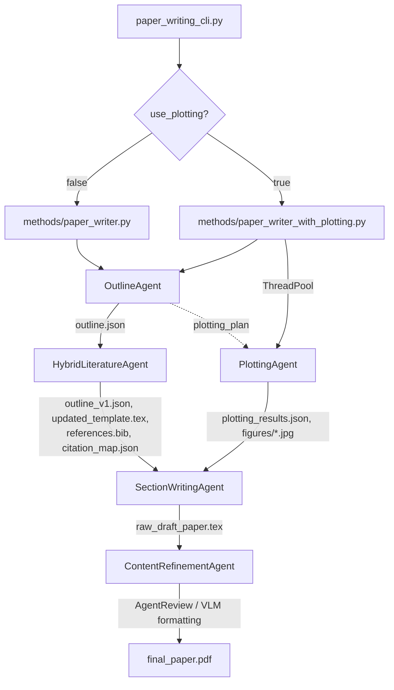

# PaperOrchestra 架构：多智能体“乐队”协作

> 基于源码快照 `d9bae99`。本文描述每个 agent 的真实输入、输出与相互依赖。

## 1. 总体架构

PaperOrchestra 采用 **轻量编排器 + 文件交接 + 专门 agent** 的架构。没有中央状态机库；`write_single_paper()` 用顺序调用、线程池和一层三次重试控制流程。所有 agent 以磁盘文件为契约：JSON、Markdown、`.tex`、`.bib`、PDF 和截图。



### 1.1 两种编排路径的差异

| 路径 | 入口 | 差异 |
|---|---|---|
| 不绘图 | `methods/paper_writer.py:write_single_paper` | 从 `raw_materials/figures/` 复制用户图片；要求目录存在，否则 CLI 打印警告 |
| 绘图 | `methods/paper_writer_with_plotting.py:write_single_paper` | 创建空 `figures/`；Outline 后把 Literature 与 Plotting 放进 `ThreadPoolExecutor(max_workers=2)` 并行；写 `time_breakdown.json` |

两条路径都在开始时删除既有 `latex_writeup/` 与 `final_paper.pdf`，并把会议模板目录整体复制到 `latex_writeup/`（模板目录必须含 `guidelines.md` 与 `template.tex`）。

## 2. 各 Agent 的职责

### 2.1 OutlineAgent：总谱与分谱

源码：`methods/agents/outline_agent.py`，Prompt：`methods/prompts/outline_agent.py`。

**输入**：

- `idea.md`（CLI 默认文件名 `idea_sparse.md`）
- `experimental_log.md`
- `template.tex`
- `guidelines.md`

**输出**：`outline.json`，三个顶层键：

```text
plotting_plan: [{figure_id, title, plot_type, data_source, objective, aspect_ratio}]
intro_related_work_plan: {introduction_strategy, related_work_strategy}
section_plan: [{section_title, subsections:[{subsection_title, content_bullets, citation_hints}]}]
```

Prompt 约束值得注意：

- `plot_type` 必须是 `plot|diagram`；`data_source` 必须是 `idea.md|experimental_log.md|both`；宽高比限定在枚举集合；`figure_id` 不得含 “Figure”。
- Introduction 负责宏观语境（10–20 篇），Related Work 负责技术基线（30–50 篇），并要求避免检索范围重叠。
- 所有论文必须早于 `research_cutoff`，且不得因为 idea 中没有评测而虚构“击败 SOTA”的主张。
- 每个数据集、优化器、指标、基础模型都要有 `citation_hints`；不确定作者时使用 “research paper or technical report introducing 'X'”，禁止猜作者。
- 所有写作 prompt 追加 `utils/prompt_utils.py:UNIVERSAL_NO_LEAKAGE_PROMPT`：只用当前会话材料，不依赖训练记忆，不泄露作者身份。

### 2.2 HybridLiteratureAgent：文献乐器组

源码：`methods/agents/literature_review_agent.py`，Prompt：`methods/prompts/literature_review_agent.py`。

四阶段：

1. **Discovery & Retrieval**：从 `outline.json` 收集三类 search task（Introduction 探索、Related Work 限制查询、section_plan 的强制 citation hints）。用 Gemini `google_search` 工具并发最多 10 个任务发现候选；随后串行调用 `utils/scholar_utils.py:s2_title_search()` 用 Semantic Scholar 补全元数据，每次 sleep 1 秒以规避限流。标题用 `thefuzz.fuzz.ratio` 匹配，>70 才接受；年份/日期必须早于 cutoff。
2. **Asset Generation**：生成去重后的 `references.bib`（`@article` 或 `@inproceedings`）、`citation_map.json`（key→title/authors/venue/year/abstract），并把 citation key 注入 outline 的 `citation_candidates` 字段。
3. **Writing**：把模板、计划、idea、实验日志、citation checklist、收集到的论文 JSON 塞进 `literature_review_agent_writter_prompt`，只生成 Introduction 和 Related Work 的 LaTeX，要求保留模板其他部分不变，至少引用 90% 的收集论文，且只能引用给定 paper。
4. **Saving**：输出 `outline_v1.json`、`updated_template.tex`、`references.bib`、`citation_map.json` 到 `literature_agent_output/`，上层再拷回 `latex_writeup/`。

Pydantic 模型定义结构：`CandidatePaper`, `DiscoveryResult`, `PaperData`, `WriterOutput`。注意 `_discover_candidates()` 使用固定模型名 `gemini-3-flash-preview`，而不是 CLI 传入的 writer model；写作阶段才用 `self.model_name`。

### 2.3 PlottingAgent：图表声部

源码：`methods/agents/plotting_agent.py` 与 `utils/paper_banana_utils.py`。

`PlottingAgent.run()` 读取 outline 的 `plotting_plan`，对每个 figure 用 `ThreadPoolExecutor(max_workers=5)` 并行执行 `process_single_figure()`：

1. 根据 `data_source` 从 raw materials 中挑选 `.md` 文件；空则回退 `experimental_log.md`/`idea_sparse.md`。
2. 按任务类型（`plot` 或 `diagram`）检索 few-shot 示例。
3. `predict_figure_content()` 生成详细视觉描述；`style_figure_content()` 做风格润色。
4. `generate_figure_visuals()` 分流：
   - `plot`：让 Gemini 生成 matplotlib Python 代码，`execute_plot_code_worker()` 用 `exec()` 在**当前进程**执行并保存 JPEG base64；
   - `diagram`：调用 `generate_image_with_gemini()`，由图像模型生成图片。
5. `critique_and_revise_figure()` 最多 `plotting_max_critic_rounds` 轮；返回 “No changes needed.” 时停止。
6. `generate_figure_caption()` 生成 caption；图片写到 `figures/<figure_id>.jpg`，元数据写到 `plotting_results.json`。

架构提醒：`exec()` 没有沙盒，图表代码来自 LLM；这适合受信任的研究环境，不代表安全隔离。CLI 帮助中的“from code”只对统计plot path 成立。

### 2.4 SectionWritingAgent：正文声部

源码：`methods/agents/section_writing_agent.py`，Prompt：`methods/prompts/section_writing_agent.py`。

读取 `outline.json`、 literature 更新后的 `template.tex`、`idea.md`、`experimental_log.md`、`citation_map.json`、`figures/info.json`、`guidelines.md`。它会把 citation_map 格式化成“REFERENCE LIBRARY”，把 figures info 格式化成文件列表，并把 PNG/JPG 图片（不含 PDF）作为多模态输入传给 `utils/llm_backend_utils.py:call_llm_with_images()`。

Prompt 要求：

- 只填 `template.tex` 中缺失章节，保留已有文本与 preamble。
- 表格数字必须来自 experimental_log，使用 booktabs，不得编造。
- 使用 citation_map 中的精确 key；读 abstract 后写准确描述。
- 所有 figures 必须出现、被正文引用，且位于 Conclusion 之前（Appendix 除外）。
- 返回完整可编译 LaTeX，用 ```` ```latex ```` 包裹；解析器 `parse_gemini_latex_results()` 提取代码块。

输出：`latex_writeup/raw_draft_paper.tex`。

### 2.5 ContentRefinementAgent：评审与指挥

源码：`methods/agents/content_refinement_agent.py`，Prompt：`methods/prompts/content_refinement_agent.py`；格式化反馈 prompt 在同函数调用中内联。

该 agent 负责两轮循环：

**A. 内容精炼（最多 `max_reflections=3` 次）**

1. 编译初稿为 `initial_draft.pdf`，失败则直接返回错误字符串。
2. `autoraters/agent_review.py:perform_review_agentreview()` 生成审稿：默认 3 个 reviewer ensemble + 1 个 meta-review，输出 JSON 评分（Overall 1–10 等）。
3. 每轮把当前 PDF 字节、review、guidelines、experimental_log、citation_map、历史 worklog、当前 LaTeX 发给模型；要求返回 JSON worklog + 完整 LaTeX。
4. 新 LaTeX 编译成功才算候选；重新审稿后按 Overall 比较：
   - Overall 上升：接受，继续；
   - Overall 下降：停止并保留上一版本；
   - Overall 相同但子项 drop > gain：停止；否则接受。
5. 记录到 `content_refinement_worklog.json`。

**B. 格式精炼（`max_formatting_loops = 1`）**

1. `pdf_to_grid_images()` 把 PDF 页面转 2×2 网格截图。
2. VLM 按 `guidelines.md` 检查每个图表和版面问题，输出 JSON。
3. 若有 issue，则让模型只做格式修改；新 LaTeX 编译成功才接受，结果写 `format_refinement_worklog.json`。

最终输出：`content_refinement_workdir/final_refined_paper.tex` 与 `final_refined_paper.pdf`，上层复制 PDF 为 `base_dir/final_paper.pdf`。

### 2.6 AgentReview：外部评审器

`autoraters/agent_review.py` 提供 AgentReview 风格 persona（Knowledgeable/Responsible/Benign 默认开启）与 1–10 分 rubric。三条调用路径：

- ensemble reviewer 数 >1：多次调用 Gemini 生成独立 review，再由 area-chair meta-review 聚合，随后对各项分数取均值四舍五入；
- =1：直接使用单条 JSON；
- 失败时返回 `{"Error": ..., "Overall": 0}`，内容精炼循环会据此停止接受候选。

## 3. LLM 后端与共享工具

`utils/llm_backend_utils.py` 根据 model name 字符串路由：名字含 `gpt`/`o1`/`o3` → OpenAI；其他 → Gemini。系统指令在 OpenAI 侧转换为 `system`/`developer` role，在 Gemini 侧作为 `system_instruction`。

统一解析器处理三种响应：

- `parse_gemini_json_results` / `parse_openai_json_results`：从 ```` ```json ```` 或裸 JSON 提取，且有控制字符/trailing comma/转义修复；
- `parse_gemini_latex_results`：提取 ```` ```latex ```` 代码块；
- `parse_gemini_json_latex_response`：一次提取 JSON worklog 与 LaTeX，返回序列化 JSON 字符串供 refinement 再解析。

Gemini 客户端在 `utils/gemini_utils.py:get_genai_client()` 中惰性创建：优先 Vertex AI（`VERTEX_AI_PROJECT` + `VERTEX_AI_LOCATION`），否则 `GEMINI_API_KEY`。OpenAI 客户端在 `utils/openai_utils.py:get_openai_client()` 中惰性要求 `OPENAI_API_KEY`。API 调用共通重试 5 次，指数退避，token 超限/400 类错误不重试。

## 4. 架构约束与风险点

1. **文件契约强于类型契约**：agent 之间通过固定文件名交接；改名必须同步 writer、agent 与 frontend。
2. **多数 LLM 输出靠 prompt + 正则修复**，不是严格 schema；`json_repair` 只在绘图相关模块使用。
3. **并行度有两层**：writer 层中 literature 与 plotting 并行（2 workers）；literature 内部 Google discovery 10 workers；plotting 内部 5 workers。API 限流与费用需据此估算。
4. **模板驱动而非生成器驱动**：LaTeX 的 preamble/风格来自 target template；agent 不应随意引入新包。`format_agent` prompt 也明确禁止无必要的新包。
5. **无 GPU 依赖**：所有模型推理走远端 API；本地只用 matplotlib、PDF/图像工具和 pdflatex。
6. **匿名性硬约束**：所有写作 prompt 都拼接 no-leakage 文本；模板中的作者占位符不应被替换为真实身份。
