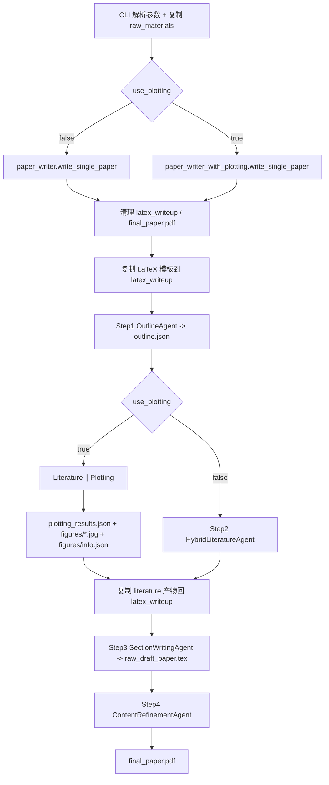

# PaperOrchestra 流水线与数据流

> 基于源码快照 `d9bae99`。本文追踪“原始实验日志/笔记 → LaTeX/PDF/图表”的完整文件流。

## 1. 输入契约

### 1.1 CLI 要求的目录

```text
raw_materials/
├── idea_sparse.md          # 默认 --idea_filename；也可改成 idea_dense.md 等
├── experimental_log.md     # 默认 --experimental_log_filename
└── figures/                # 可选；无 plotting 路径时的用户图片
    ├── *.png / *.pdf / *.jpg / *.jpeg
    └── info.json           # 可选但重要：SectionWritingAgent 读取的 {name, caption} 列表
```

CLI 会检查 `raw_materials_dir` 是否存在；若 `--output_dir` 未指定，则创建 `./paper_output_<YYYYMMDD_HHMMSS>/`。如果目标 `base_dir/raw_materials` 与输入目录不同，CLI 会先删除后者再 `copytree` 整份材料，保证每个 run 自包含。

无绘图模式下，CLI 扫描 `figures/` 下是否有 `.pdf/.png/.jpg`，没有则打印醒目警告：编译可能因缺图失败。但注意：**无绘图路径只复制图片目录，不自动生成 `figures/info.json`**；`SectionWritingAgent._read_json()` 在文件缺失时返回空字典，因此不会自动引用这些图片。若希望正文自动插图，需要提供 `info.json`，或启用 plotting 路径。

### 1.2 内容要求

`experimental_log.md` 是数字真实性来源：Prompt 多处要求表格数字、作者问题回答和审稿修订都必须以它为准。`idea.md` 是方法与贡献来源。两者越结构化（题目、方法、实验设置、原始表格、定性观察），outline 的 citation hints 和绘图计划越可靠。仓库 README 说明数据集未随代码发布；`frontend/examples/cvpr_example.json` 提供 idea/log/figure/caption 示例。

## 2. 顶层执行流程



`write_single_paper()` 用 `while (not succeed) and cur_try < 3` 包住整个流程；任何断言或异常都会打印 traceback 并整体重试。因此中间产物可能被覆盖，不能把旧 run 的 `outline.json` 当成最终真相。

## 3. 逐步数据流

### Step 0：模板实例化

`--latex_template_dir` 整个目录被复制到 `base_dir/latex_writeup/`。硬性要求：

- `guidelines.md`：会议页数/匿名性/图表规则，进入 outline、section writing、refinement、format review prompt。
- `template.tex`：章节骨架，Literature Agent 只填 Introduction/Related Work，SectionWritingAgent 填其余。
- `references.bib`、`.sty`、`.bst` 等由模板提供，供 pdflatex 使用。

当前仓库提供 `templates/cvpr2025/` 与 `templates/iclr2025/`。虽然 Prompt 中频繁出现 NeurIPS/ICML 作为风格示例，仓库里**没有** `templates/neurips*` 或 `templates/icml*` 目录。CLI 可以传任意模板目录；Streamlit 侧 `frontend/app.py:render_sidebar()` 的下拉框硬编码为 `["cvpr2025", "iclr2025"]`。要输出 NeurIPS/ICML 格式，需自备合规模板；使用 UI 时还要同步修改下拉列表。

### Step 1：Outline

输入：`idea_sparse.md`, `experimental_log.md`, `template.tex`, `guidelines.md`。
输出：`base_dir/outline.json`。

三个关键分支：

- `plotting_plan` → 绘图 agent 的工单；
- `intro_related_work_plan` → 文献检索任务与“钩子/问题缺口/限制假设/bridge”；
- `section_plan` → 各章节 bullet 与必须引用的 dataset/metric/baseline 提示。

### Step 2：文献与绘图

**文献分支**（两条路径共有）：

```text
outline.json ──collect_search_tasks──> 多个 search task
   ├─ Gemini google_search 并发发现 CandidatePaper（max_workers=10）
   ├─ Semantic Scholar 逐条补全 PaperData（sleep 1s，标题相似度 >70）
   ├─ 去重 registry ──> references.bib + citation_map.json
   ├─ citation_candidates 注入 outline ──> outline_v1.json
   └─ 写入 Introduction / Related Work ──> updated_template.tex
```

输出目录：`base_dir/literature_agent_output/`。上层随后复制：

| 源 | 目标 |
|---|---|
| `outline_v1.json` | `base_dir/outline.json` |
| `updated_template.tex` | `base_dir/latex_writeup/template.tex` |
| `references.bib` | `base_dir/latex_writeup/references.bib` |

**绘图分支**（仅 plotting 路径）：

```text
outline.plotting_plan ──ThreadPool(5)──> process_single_figure
   ├─ raw md 选择 ──> few-shot ──> figure description ──> style
   ├─ plot  : Gemini 生成 matplotlib 代码 ──> exec() ──> JPEG base64
   ├─ diagram: Gemini 图像模型 ──> base64
   ├─ critic 最多 plotting_max_critic_rounds 轮
   └─ caption 生成
       ↓
base_dir/plotting_results.json
base_dir/figures/<figure_id>.jpg
latex_writeup/figures/<figure_id>.jpg
latex_writeup/figures/info.json  [{name, caption}]
```

`paper_writer_with_plotting.py` 只复制 plotting_results 中带 `image_path` 且源文件存在的图片，并据此生成 `info.json`；失败的图片不会进入 LaTeX。

### Step 3：正文写作

输入汇总进入 `call_llm_with_images()`：outline、citation library、idea、实验日志、figures info、guidelines、更新后的 template.tex，以及所有栅格图（PDF 不传给 VLM）。输出 `latex_writeup/raw_draft_paper.tex`。

数据约束：

- 表格必须来自 `experimental_log.md`，不允许幻觉数字；
- citation 只能用 `citation_map.json` 中的 key；
- 图片必须用 `figures/` 下的精确文件名，且全部出现在 Conclusion 之前；
- 保留 preamble 和已完成章节，只补缺失部分。

### Step 4：内容/格式精炼

```text
raw_draft_paper.tex
   ↓ 写入 initial_draft.tex + compile_latex (pdflatex→bibtex→pdflatex×2)
initial_draft.pdf
   ↓ pdf_to_grid_images + AgentReview（3 reviewers + meta）
review_v0.json / peer_reviews/
   ↓ 最多 3 轮：PDF + review + log + citations + current TeX
   → JSON worklog + full revised LaTeX
   → 编译成功才参与评分比较
final_valid_pdf
   ↓ 1 轮 VLM 格式检查（截图 + guidelines）
   → 仅格式修改；编译成功才接受
content_refinement_workdir/final_refined_paper.{tex,pdf}
   ↓ 复制到 base_dir/final_paper.pdf
```

记录文件：

- `content_refinement_workdir/content_refinement_worklog.json`：每轮 scores_before/after、deltas、gain/drop、outcome；
- `content_refinement_workdir/format_refinement_worklog.json`：格式反馈与接受/编译失败结果；
- `content_refinement_workdir/peer_reviews/review_*.json`：审稿 JSON；
- `content_refinement_workdir/pdf_screenshots/`：内容/格式两组的页面网格图。

## 4. 输出目录

```text
base_dir/
├── raw_materials/                 # 输入副本
├── outline.json                   # 最终 outline（含 citation_candidates）
├── literature_agent_output/
│   ├── outline_v1.json
│   ├── updated_template.tex
│   ├── references.bib
│   └── citation_map.json
├── plotting_results.json          # 仅 plotting 路径
├── figures/                       # 仅 plotting 路径：生成图 base64 已转 jpg
├── latex_writeup/
│   ├── template.tex               # 已填 Intro/Related Work
│   ├── references.bib
│   ├── figures/                   # 用户图或生成图 + info.json（plotting 路径）
│   ├── raw_draft_paper.tex
│   └── 模板自带的 .sty/.bst/guidelines.md
├── content_refinement_workdir/
│   ├── initial_draft.{tex,pdf}
│   ├── refined_paper_v1..N.{tex,pdf}
│   ├── formatted_candidate_v1.{tex,pdf}
│   ├── final_refined_paper.{tex,pdf}
│   ├── content_refinement_worklog.json
│   ├── format_refinement_worklog.json
│   ├── peer_reviews/
│   └── pdf_screenshots/
├── time_breakdown.json            # 仅 plotting 路径
└── final_paper.pdf                # 最终交付
```

注意最终交付是 PDF；用户若需要 LaTeX 源，取 `content_refinement_workdir/final_refined_paper.tex`。

## 5. 批处理数据流

`methods/paper_writer.py:run_batch_writeup()` 提供无绘图批量模式：

- 输入二选一：`process_root_folder=True` 时扫描 `<root>/<paper_id>/raw_materials/` 与 `<paper_id>.pdf`；否则读取 `paper_info_path` JSON，entrry 含 `paper_id/content_folder/pdf_path`。
- `n_papers < 0` 表示全部，否则截断。
- `paper_writing_log.json` 支持断点续跑：已有 `status=success` 且 paper_path 存在的条目会跳过。
- `ProcessPoolExecutor(max_workers)` 并发调用 `process_paper_task()`；每个 worker 复制 content_folder 与原始 PDF 到 `<output>/<paper_id>/raw_materials/`，然后调用 `write_single_paper()`。
- 结果实时写回 `paper_writing_log.json`，结构为 `{paper_id: {status, paper_path}}`；项目结构里 dataset 未包含，脚本 `paper_writing_cli.sh` 展示的是预期布局。

批处理路径没有 `reflection_model_name` 参数，内部使用 `write_single_paper()` 默认值作为精炼模型。

## 6. Streamlit 数据流

`frontend/app.py` 不直接调用 writer，而是：

1. 用户在 UI 输入 idea/log、上传图片、选模型和模板；Email 是必填项（用于通知）。
2. 写入 `../demo_logs/paper_orchestra_run_<timestamp>/raw_materials/{idea_sparse.md,experimental_log.md,figures/}`。
3. 以 `subprocess.Popen([sys.executable, "-u", paper_writing_cli.py, ...])` 启动 CLI；Linux 下通过 `prctl(PR_SET_PDEATHSIG, SIGKILL)` 让父进程退出时杀掉子进程。
4. 逐行读 stdout，按日志关键词映射到“Outline / Literature Review / Figure Plotting / Section Writing / Content Refinement”等进度阶段。
5. 完成后展示 `final_paper.pdf`、截图、`plotting_results.json`、content/format worklog，并提供下载；可选通过 `frontend_utils.send_notification_email()` 用 Gmail SMTP 发送附件。

因此 Streamlit 是 CLI 的可视化外壳，不改变数据流。

## 7. 失败处理与可观测性

- 单篇管线整体最多重试 3 次；每次从模板复制开始，清理前一次 `latex_writeup/` 和 PDF。
- LLM API 调用统一重试 5 次，指数退避；400/token 超限不重试。
- PDF 编译失败时 `utils/pdf_utils.py:compile_latex()` 打印每条命令的 stdout/stderr；精炼循环遇到编译失败会保留上一版 PDF。
- 评审 Overall 下降会停止内容精炼并回退到上一个接受版本，避免“越改越差”。
- 绘图单图失败不会中断整篇：ThreadPool future 的异常被捕获并打印，其他图继续。
